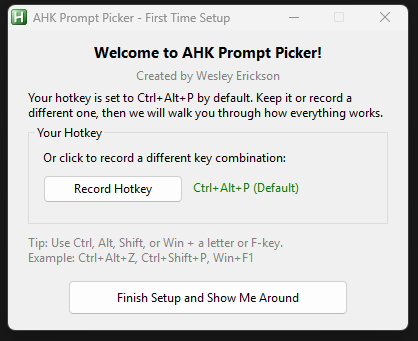
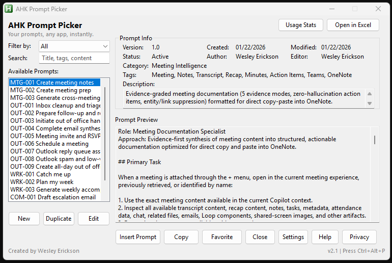
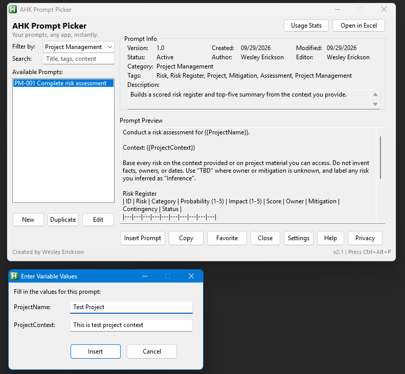
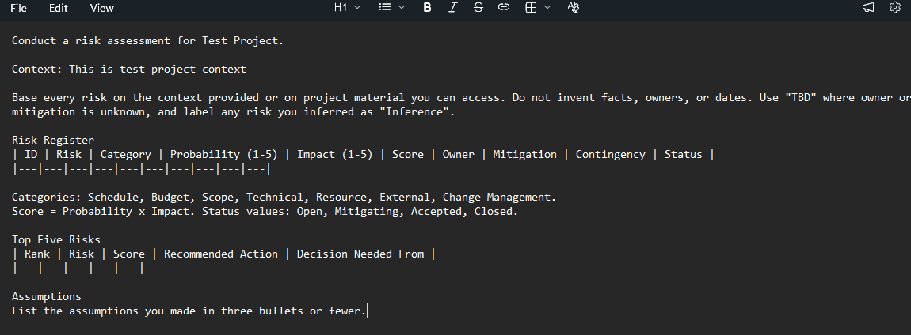

# AHK Prompt Picker

Your own prompt library, one hotkey away in most Windows apps.


Press a hotkey, pick a prompt, and the text lands where your cursor is: Copilot chat, Teams, Outlook, a browser, anything with a text box. The library is a plain Excel file you own. No account, no service, nothing to host.


## Features

- **One hotkey, most apps.** `Ctrl+Alt+P` by default, and you can record your own.
- **Excel is the database.** One sheet, one row per prompt. Edit in the picker or in Excel. The picker reloads the library when you save.
- **Fill-in-the-blank variables.** Write `{{ProjectName}}` in a prompt and the picker asks for each value before it pastes.
- **Find prompts fast.** Filter by category, Favorites, Archived, Most used, or Recently used. Search covers ID, title, category, tags, description, and content.
- **Manage the library in place.** Add, edit, duplicate, favorite, and archive prompts.
- **Local only.** No network calls, no analytics. Your clipboard is restored after each paste.
- **18 starter prompts** for meetings, Outlook, weekly planning, communication, and project risk.

## Requirements

- Windows
- [AutoHotkey v1.1](https://www.autohotkey.com/download/1.1/). The script uses v1 syntax and does not run on v2. Tested on 1.1.30.03 and 1.1.37.02.
- Microsoft Excel desktop. The script reads and writes the library through Excel COM automation.

## Install

1. Download the latest ZIP from [Releases](../../releases), or clone the repo:

   ```bash
   git clone https://github.com/wesleyericksonpmp/AutoHotkey-PromptPicker.git
   ```

2. Put the folder somewhere stable, such as `%LocalAppData%\PromptPicker`. Avoid a OneDrive-synced folder, because sync can lock the Excel file while you edit.
3. Double-click `prompt-picker-p.ahk`.
4. The first-run screen shows the default hotkey. Keep it or click **Record Hotkey**.

   

5. Click **Finish Setup and Show Me Around**, then try a prompt in any text field.

To start the picker when you sign in, open **Settings** from the tray icon and check **Start AHK Prompt Picker when I sign in to Windows**. This adds a shortcut to your Startup folder.

## Usage

1. Click into any text field.
2. Press your hotkey.
3. Select a prompt and press **Enter** or click **Insert Prompt**.



### Variables

Any `{{VariableName}}` in a prompt becomes a field you fill in before the text is pasted. Every occurrence of the same variable is replaced.



The filled-in prompt is pasted at your cursor:



## Prompt library format

`prompt_library.xlsx` holds one sheet with one row per prompt.

| Column | Purpose |
|---|---|
| ID | Unique key, such as `MTG-001` |
| Title | Name shown in the list |
| Content | The prompt text. Supports `{{Variables}}`. |
| Category | Used by the category filter |
| Version | Free text |
| Created, CreatedBy | Set when a prompt is added in the picker |
| Modified, ModifiedBy | Set when a prompt is saved in the picker |
| Status | `Active` or `Archived` |
| Tags | Comma-separated, searchable |
| Description | Short summary shown in the info panel |
| OutputFormat | What the prompt asks the AI to return |
| TargetApp | Comma-separated apps the prompt suits |

To add a prompt in Excel, type a new row directly below the last one. Save or close Excel before the picker writes to the file.

## Files the script creates

These files live next to the script and are excluded by `.gitignore`.

| File | Contents |
|---|---|
| `settings.ini` | Hotkey and preferences |
| `favorites.ini` | IDs of starred prompts |
| `usage.ini` | Prompt IDs, use counts, and last-used times. Never prompt text or the target app. |

## Privacy

Everything runs on your computer. The script has no accounts, no analytics, and makes no network calls. To paste, it puts the prompt on the clipboard, sends `Ctrl+V`, and then restores your previous clipboard. It does not read keystrokes or screen content.

## Troubleshooting

| Symptom | Fix |
|---|---|
| "File is locked" on open or save | Close any other Excel window that has `prompt_library.xlsx` open. If none is open, end the leftover `EXCEL.EXE` process in Task Manager. |
| The hotkey does nothing | Check for the green **H** icon in the system tray. Open Settings and confirm the hotkey. Another app may already use that combination. |
| First press shows "Loading your prompts..." | Excel is starting in the background. The picker opens when it is ready. |
| Syntax error on launch | You are running AutoHotkey v2. Install v1.1. Both versions can be installed side by side. |
| The prompt does not paste in a specific app | Some apps block simulated `Ctrl+V` or ignore pasted text. This is common in apps running as administrator, remote desktop sessions, and some terminals and games. Click **Copy** in the picker instead, then paste manually with `Ctrl+V` or the app's own paste command. |

## Roadmap

This repo is the free AutoHotkey version. A cross-platform desktop app built with Tauri is planned. A port to AutoHotkey v2 is not planned.

## Contributing

Issues and pull requests are welcome. For a bug, include your AutoHotkey version, Excel version, and the steps to reproduce.

## License

[MIT](LICENSE) © 2026 Wesley Erickson · [pmpmaker.com](https://www.pmpmaker.com)
